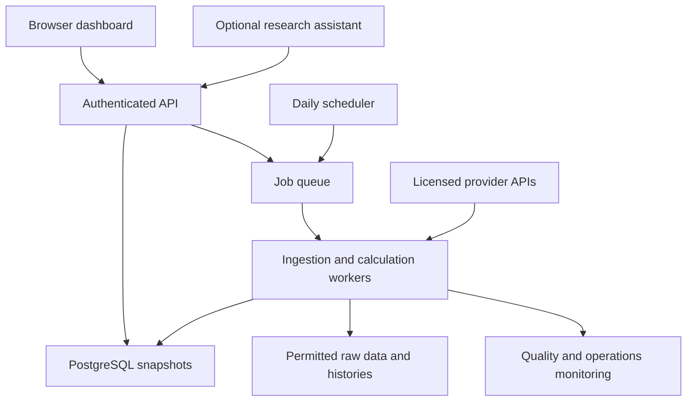

# Investment Research Web App Specification

Product requirements and technical architecture

Prepared for Shahin Shariat | Version 1.0 | 5 November 2026

## 1 Recommended approach

Build a research dashboard that screens a broad investment universe every day, explains why candidates qualify, and compares their valuation, financial quality, growth, performance and risk. Use deterministic calculations for metrics and rankings, with optional AI summaries grounded in the underlying evidence. The output is a research shortlist, not an assurance of future returns.

Start with Financial Modeling Prep (FMP) as the principal commercial-data integration, subject to a paid coverage trial and written confirmation of the intended display rights. Its documented interfaces cover financial statements, market prices, analyst estimates, fund information, holdings and bulk delivery. EODHD is a credible alternative and a useful selective cross-check. Add Morningstar when comprehensive Canadian and UK mutual-fund share classes, detailed fund analytics or licensed analyst research become essential. [S01–S04, S07–S09]

Use ordinary HTTPS APIs and bulk files for scheduled ingestion. Use MCP only for the optional research assistant. MCP changes how an AI system calls a service; it does not provide an independent dataset, unlimited usage or redistribution rights. FMP and EODHD both document official MCP services. [S05–S06]

The main design decisions are:

- Maintain separate stock, equity-fund and fixed-income-fund models. A bond fund and a technology stock cannot be ranked meaningfully using the same P/E-based formula.
- Show two distinct results: investment attractiveness within a peer group, and current market attention. Popularity must not be presented as evidence of undervaluation.
- Store every input with its source, period and observation time. Show data coverage and freshness beside each score.
- Build a modular application with background workers, PostgreSQL and object storage. A daily research service does not initially need a streaming market-data platform.
- Make global fund coverage a contractual acceptance criterion. A provider advertising global securities does not establish complete data for every Canadian fund series or UK accumulation and income share class.

**Verification status.** Provider capabilities, endpoints and the field mappings below were checked against public primary documentation on 5 November 2026. These are documentation checks, not authenticated subscription tests. Public demo URLs could not be retrieved through the research channel. Actual population, entitlements, latency and licensing must pass the trial described in Section 20. Unconfirmed features are explicitly conditional and must not silently appear as supported.

## 2 Scope and operating assumptions

The initial deployment is a private application for a Canadian investor, with CAD as the default presentation currency and optional USD and GBP views. Target US, Canadian and UK listed equities and ETFs; include supported US mutual funds. Canadian and UK mutual funds remain an explicit expansion requirement, enabled once the relevant share classes pass provider validation. This is a proposed implementation sequence, not a claim that all fund coverage is already secured.

The system should support 100,000 instrument and listing records, screen a configured universe of up to 20,000 eligible listings daily, maintain ten years of daily prices where available, and retain five annual and eight quarterly financial periods for the initial calculation set. These are engineering targets; they are not provider coverage claims. Initially enrich approximately 2,000 candidates and watched instruments more deeply each day.

| Dimension | Initial requirement | Expansion |
|---|---|---|
| Users | One owner; optionally invited viewers | Multiple tenants with independent entitlements |
| Prices | End-of-day and clearly labelled delayed snapshots | Licensed real-time quotes if justified |
| Asset types | Common stocks, conventional ETFs, supported mutual funds | Specialist REIT, bank, bond and alternative-fund models |
| Discovery | All eligible instruments scanned daily | Additional exchanges and specialised screens |
| Research horizon | Configurable; default medium to long term | Separate tactical screens with separate validation |
| Execution | Watchlists, comparison and research exports | Broker integration is a separate project |

Exclude automatic trading, options valuation, leveraged/inverse-product ranking, personalised tax calculations and claims of guaranteed outperformance from version 1. Display leveraged, inverse, commodity, money-market and alternative products in dedicated categories if ingested, with only applicable metrics. Do not silently discard them from search.

## 3 Product requirements and user journeys

The main journey is: open the daily dashboard, inspect newly qualified investments, understand the reasons and risks, compare selected instruments, then save a watchlist or research note. The app must discover candidates without requiring the user to know their tickers first.

| ID | Requirement | Acceptance evidence |
|---|---|---|
| FR01 | Search by name, ticker, ISIN and exchange | Duplicate tickers and share classes resolve unambiguously |
| FR02 | Run daily discovery over the configured universe | Run log records eligible, evaluated, excluded and failed counts |
| FR03 | Offer Refresh prices, Refresh analysis and Run discovery now | Each creates or joins a tracked background job |
| FR04 | Filter by type, region, sector, size, liquidity and score | Saved screen reproduces its rules and model version |
| FR05 | Compare 2–8 investments | Common metrics align; inapplicable values read N/A |
| FR06 | Explain every score and rank movement | User can inspect factors, weights, inputs and timestamps |
| FR07 | Show new entrants, exits and material changes | Compare against the last completed compatible snapshot |
| FR08 | Maintain watchlists and notes | Owner changes persist and are isolated from other users |
| FR09 | Provide dated source links and data-quality status | Every displayed financial value has traceable provenance |
| FR10 | Export permitted CSV and research reports | Export includes currency, period, source and as-of date |
| FR11 | Configure daily time and screening presets | Schedule respects the selected IANA time zone |
| FR12 | Show provider status, quotas and incomplete datasets | Provider failures cannot turn missing values into zero |

Provide presets for quality at a reasonable price, profitable growth, improving fundamentals, dividend sustainability, low-cost diversified equity funds and defensive fixed-income funds. Presets are editable analytical rules, not investment recommendations issued by a provider.

Alerts should initially appear inside the app: a new qualifying candidate, significant score deterioration, a new earnings release, or a watchlist item becoming stale. Email or push delivery is a later opt-in integration with frequency limits and unsubscribe controls.

## 4 Daily discovery and the definition of high potential

“High potential” means a candidate satisfies a defined investment hypothesis using observable data. It must not mean that the app predicts a particular gain with certainty. Every candidate should disclose its applicable peer group, model and qualifying conditions.

1. Synchronise instrument directories, symbol changes and active status. Preserve delisted records for research history.
2. Update daily prices and corporate actions across the full eligible universe. Recompute valuation denominators against the new prices even when statements have not changed.
3. Apply hard eligibility rules before ranking. Proposed default stock rules are market value at least USD 300 million equivalent, 60-session median daily traded value at least USD 1 million, and sufficient price and financial history. These thresholds are tunable design choices, not evidence that smaller companies are unattractive.
4. Calculate broad valuation, quality, growth and momentum features from the latest valid cached fundamentals and prices. Refresh changed statements using earnings and filing signals; use a rolling refresh sweep to catch missed changes.
5. Select approximately 2,000 deeper-research candidates from several sources: broad composite leaders, improving quality, attractive valuations, positive growth and unusual attention. Use a union of lists so a single popular theme cannot monopolise discovery.
6. Fetch estimates, relevant news and holdings for candidates and watchlists. Resolve data exceptions, then recompute rankings.
7. Publish an immutable daily snapshot only when its quality gates pass. Record shortlist entrants, exits, rank changes and the underlying explanations.

The optional Attention score combines 40% six-month relative-return percentile, 35% abnormal-volume percentile and 25% recent-news-activity percentile. Volume compares a completed session with the prior 20 comparable sessions; partial-session volume must not be compared with full days. News activity counts deduplicated ticker-linked stories over seven days relative to a trailing baseline, with source-diversity checks. If news coverage is incomplete, label the score as price-and-volume attention and use a separately versioned model.

Do not use unlicensed social scraping as a dependency. A trending label can be computed entirely from prices, volume and the subscribed news feed. News sentiment is optional; the initial model does not require a sentiment field that may be absent from the selected API.

## 5 Financial evidence and metric selection

There is no universally best indicator of future stock returns. The most defensible default is a combination of valuation, profitability, balance-sheet resilience and improving business expectations. Analyst price-target upside is useful context, but cannot establish that an investment is undervalued.

CFA Institute describes both market multiples and discounted cash-flow approaches as widely used by professional analysts. MSCI's quality methodology emphasises profitability, earnings stability and leverage. Damodaran's valuation framework connects growth to reinvestment and returns on capital. Zacks uses changes in earnings expectations in its ranking methodology. These support the dimensions selected here; they do not validate the particular weights proposed for this app. [S27–S30]

For a profitable non-financial company, the recommended headline value metric is free-cash-flow yield, interpreted alongside enterprise valuation, ROIC and growth. A temporarily high yield can reflect a cyclical peak, shrinking investment or distress. For a diversified fund, fees relative to suitable peers are a stronger initial selection input than the unit price; Morningstar's historical research supports the relevance of expense ratios to subsequent fund outcomes. [S31]

### Common comparison metrics

| KPI | Applies to | Interpretation and limitation |
|---|---|---|
| Total return over 1, 3 and 5 years | All, with sufficient history | Include reinvested distributions; no inference of future return |
| Annualised volatility and maximum drawdown | All | Same currency, calendar and measurement window |
| Benchmark-relative return | All | A suitable benchmark is essential; label ETF proxies |
| Sharpe ratio | All, conditionally | Requires a documented currency-matched cash-rate assumption |
| Distribution yield | Stocks and distributing funds | Separate dividends, interest and return of capital when known |
| Valuation exposure | Stocks and equity funds | Direct fundamentals versus holdings-derived valuation |
| Liquidity and trading friction | Listed instruments | Mutual funds use dealing terms, loads and redemption rules |
| Data confidence | All | Input completeness and freshness, not confidence of profit |

### Stock fundamentals

| KPI | Calculation convention | Interpretation |
|---|---|---|
| FCF yield | TTM operating cash flow minus positive cash capex, divided by current equity market value | Higher can indicate better value; compare peers and history |
| Earnings yield and P/E | TTM diluted EPS / price; reciprocal only if EPS is positive | Losses make P/E not meaningful |
| EV / EBITDA | Enterprise value divided by positive TTM EBITDA | Useful for comparable operating companies; weak for banks |
| Revenue and EPS growth | Latest TTM versus prior TTM; 3-year CAGR only with valid positive endpoints | Distinguish growth from recovery from losses |
| ROIC | NOPAT divided by average invested capital, under a versioned definition | Compare persistence and sector economics |
| Operating margin | Operating income / revenue | Trend and stability matter alongside level |
| Net debt / EBITDA | Consistent interest-bearing debt less defined cash / EBITDA | Suppress when EBITDA is non-positive |
| Interest coverage | Positive EBIT / positive interest expense | Zero or missing interest is not infinite coverage |
| Cash conversion | Operating cash flow / net income when net income is positive | Flag persistent weak conversion |
| Dilution and SBC | Change in diluted shares; stock-based compensation / revenue | Growth may not accrue equally to each share |
| Estimate revision | Change in consensus for the same target fiscal period | Needs stored historical snapshots |
| Analyst target upside | Median target / comparable current price minus one | Show dispersion, coverage and dates when available |

Dividend sustainability is a secondary lens: cash dividends / FCF and dividends / earnings only where denominators are positive. Never rank a stock highly solely for a large dividend yield.

## 6 Calculation rules and stock scoring

Use end-of-day prices for the official daily score. An intraday refresh may show a provisional score with a distinct timestamp. Comparisons must not mix today's provisional stock score with an unlabelled prior-close fund score.

For each metric, build peer groups by asset subtype, industry and region; prefer at least 30 valid members. If a group is too small, broaden to sector and then region, displaying that fallback. Apply eligibility before percentile calculation. Use mid-ranks for ties, winsorise continuous observations at the 2nd and 98th percentiles, and reverse the direction for metrics where lower is preferable. Keep the uncapped original number visible.

| Component | Weight | Initial inputs |
|---|---|---|
| Value | 30% | Equal contributions from FCF yield, earnings yield and inverse EV / EBITDA |
| Quality | 25% | ROIC 40%, operating margin 30%, cash conversion 30% |
| Growth | 20% | TTM revenue growth 50%, diluted EPS growth 50% |
| Financial resilience | 15% | Inverse net debt / EBITDA 60%, interest coverage 40% |
| Momentum | 10% | Twelve-month total return excluding the most recent month |

**Core score v1** is the weighted sum of available component percentiles after the rules below. It is a relative research rank from 0 to 100, not expected percentage return or probability of success. Maintain separate model versions for banks, REITs and loss-making companies; until validated, show their applicable metrics without the general composite.

An optional **Estimate-enhanced score v1** uses Value 30%, Quality 25%, Growth 15%, Resilience 15%, Momentum 5% and Estimate revisions 10%. The revision factor averages 30-day and 90-day changes for a fixed target fiscal period. It becomes available only after sufficient stored history, analyst coverage and basis checks. Display it in a separate ranked list; do not mix differently weighted models in one league table.

**Missing-data rules.** Calculate metric coverage against the model's original weights. At least 80% of total weight must be valid, every component must retain at least 50% of its planned input weight, and mandatory inputs—identity, eligible price, valid statements and currency—must be present. Renormalise only within a qualifying component and publish the resulting effective weights. Otherwise show “Insufficient data” rather than a composite. The 80% and 50% values are proposed acceptance defaults, to be calibrated during the trial.

**Example using invented data.** Component scores of 80, 70, 65, 60 and 75 produce a core score of 71.0: 24 + 17.5 + 13 + 9 + 7.5. This calculation illustrates the model only and is unrelated to any current security. A simultaneous Attention score of 92 means attention is elevated; it does not increase the core valuation score.

**Estimate discipline.** The date in an estimate record is the forecast period, not the time the analyst made the estimate. Store retrieval time separately. Compare matching fiscal periods, GAAP/adjusted basis and currency. Do not substitute analyst-count changes for revision breadth. Current consensus snapshots do not disclose how many individual analysts revised upward. FMP's own guidance describes storing repeated observations for a revision signal. [S16, S26]

## 7 Fund and ETF analysis

Identify the fund portfolio, share class and exchange listing separately. An accumulation class and an income class may own the same portfolio while differing in distributions, fees and dealing arrangements. A CAD trading line does not imply CAD-hedged economic exposure.

| Metric | Equity funds and ETFs | Fixed-income funds |
|---|---|---|
| Cost | Net expense ratio, OCF or MER with precise label | Same; do not treat management fee as total cost |
| Diversification | Top-ten weight, largest holding, sector/country exposure | Issuer, sector, country and credit concentration |
| Underlying value | Holdings-weighted earnings or cash-flow yield | Yield to maturity/worst when supplied and comparable |
| Risk | Drawdown, volatility and factor concentration | Duration, credit quality, drawdown and currency exposure |
| Implementation | Tracking difference/error, spread and premium to NAV when available | Same where relevant; additional liquidity constraints |
| Performance | Net total return versus appropriate benchmark | Match duration, currency and credit category |
| Capacity and structure | AUM, inception, domicile and replication method | AUM, derivatives and credit/interest-rate exposure |

For passive equity funds, begin with cost 40%, tracking quality 30%, diversification 20% and liquidity 10%, evaluated within the same benchmark or closely matched strategy cohort. For active funds, show cost, net benchmark-relative returns, drawdown, concentration and manager/process evidence separately; defer a composite until comparable manager and share-class data are secured. For fixed-income funds, show a category-specific dashboard before introducing a validated rank. A longer-duration fund must not win automatically because its quoted yield is higher.

Where tracking data or bid–ask spreads are unavailable, disable the full passive-fund score. A clearly named basic fund screen may still filter on fees, AUM, concentration and observed return risk. It must not masquerade as the full implementation-quality model.

**Look-through valuation.** Compute portfolio earnings yield from constituent earnings yields and position weights using a consistent date and treatment of losses. Do not average P/E ratios arithmetically. For positive-earnings holdings, the inverse of a weighted earnings yield can produce an implied P/E, but report the covered portfolio weight and loss-making exposure. Require at least 80% mapped weight for the main equity valuation display; otherwise show a partial estimate. Vendor aggregate P/E may follow another convention and must retain its source label.

**Overlap.** For two long-only portfolios, holdings overlap is the sum of the smaller weight for every common underlying security. Unmapped holdings remain unknown. Expand nested funds only with sufficient data, stop recursion on cycles, and show the effective exposure date. Derivatives require exposure measures; nominal security weight alone is not an adequate substitute.

**Return and fee treatment.** Use NAV total returns for fund-manager assessment and market-price total returns for the exchange investor's experience. Do not subtract the expense ratio again from returns already net of expenses. Accumulation prices incorporate retained income; do not reinvest a distribution that was never paid by that share class.

**Calculation conventions.** Build a total-return wealth index with a documented adjustment method. Period return is ending wealth divided by starting wealth minus one; annualise multi-year returns using the actual elapsed years. Maximum drawdown is the largest peak-to-trough percentage fall in that index. Use sample standard deviation of aligned daily returns multiplied by the square root of 252 for annualised daily volatility, with the convention disclosed. Require 252 valid observations for the standard one-year risk view; show shorter history separately.

Compute Sharpe from average periodic excess return divided by its sample standard deviation, annualised consistently. Cash rates must match the return currency and be converted to the observation frequency. A user-supplied constant cash rate is permissible only when visibly labelled as an assumption; otherwise suppress Sharpe until a validated rate series is available. Tracking error uses the sample standard deviation of aligned fund-minus-benchmark periodic returns, annualised; tracking difference is the gap in their annualised total returns over the same interval. Do not fill missing market observations with zero returns. Record the intersection of dates used and flag non-synchronous international closes.

## 8 Valuation scenarios and analyst evidence

Provide a DCF scenario workspace for suitable operating companies, with bear, base and bull assumptions. Inputs include revenue growth, operating margins, tax assumptions, reinvestment, working capital, discount rate, terminal growth, debt, cash and diluted shares. Historical API values anchor the model; future assumptions are explicitly analyst or user assumptions.

Implement FCFF as after-tax operating profit plus non-cash depreciation, less cash capital investment and increased non-cash working capital. Discount operating cash flows at a consistent WACC; reconcile operating value to common equity by adding non-operating assets and subtracting debt and other senior claims. A CFO-minus-capex screening number must not silently become FCFF. [S27]

Require terminal growth below the discount rate, display sensitivity to both inputs, show the proportion of value attributable to the terminal period, and expose the complete assumption set. For capital-intensive or unusual businesses, require review of normalisation assumptions. Store a scenario version and author. Do not rank the universe by a single vendor DCF number.

Price targets should be displayed as external opinions with high, low, median and consensus values where available. A high-low range is not a statistical confidence interval. If target age or analyst count is absent, label it unknown and suppress claims of strong consensus. FMP's main directory marks the consensus target interface as US-only; do not promise equivalent target coverage for every Canadian or UK listing. [S01, S17]

Use analyst revisions as an additional signal and source-linked research as context. Named proprietary ratings, economic moat assessments and fair-value research require the relevant licensed product; an ordinary prices or fundamentals subscription does not grant them.

## 9 Provider comparison and subscription decisions

| Provider | Best role in this app | Coverage and procurement limitation |
|---|---|---|
| Financial Modeling Prep | Initial stock and ETF fundamentals, estimates, news and bulk ingestion | Public plans distinguish personal and commercial use; verify each market and fund class [S01–S02] |
| EODHD | Alternative global daily-price and fundamentals stack; selective validation | Documents global ETFs and US mutual funds; extended bulk fundamentals is separate [S03–S04, S10] |
| Morningstar | Fund/share-class coverage, holdings, categories and licensed research | Contract and dataset specific; DWS and broader licensed-data coverage differ [S07–S09] |
| FE fundinfo | Alternative specialist for UK/global fund feeds | Discuss required share classes, fees, NAV, holdings and delivery with sales [S11] |
| LSEG | Broad institutional multi-asset content and enterprise integration | Product-level subscriptions, entitlements and quotes; not one universal API purchase [S12] |
| FactSet | Institutional fundamentals, estimates, fund reference and analytics | Multiple datasets and APIs; a reference feed alone does not provide all analytics [S13–S14] |
| Alpha Vantage | Smaller prototype or supplementary ETF/fundamental interface | Documents ETF profile/holdings and MCP; assess quotas and fund coverage before scaling [S15] |
| Massive | Optional US market microstructure and live quote layer | Useful if spreads and real-time experience become important; additional datasets apply [S24] |
| Sharadar | Optional US point-in-time fundamentals for historical testing | As-reported dimensions cover active and delisted primary common stocks [S25] |
| SEC EDGAR and Bank of Canada | Official filing validation and CAD reference FX | Supplements commercial coverage; neither is a complete market-data service [S22–S23] |

### Which offers the largest dataset

There is no defensible single winner across instrument count, fundamental completeness and fund depth. Among the providers reviewed, LSEG reports a real-time universe above 90 million instruments. That includes asset types far beyond stocks and funds. Morningstar reports more than 1.4 million offerings across its broader licensed datasets, whereas Direct Web Services describes access to over 300,000 investments. These counts describe different products and cannot be treated as comparable fully populated fundamental records. [S07–S08, S12]

For this application's affordable first build, FMP is the recommended starting point because its documented services line up well with the required workflow. For comprehensive fund research, Morningstar is the first specialist to evaluate. For the broadest institutional procurement exercise, evaluate LSEG and FactSet against a precise instrument-and-field manifest. “Largest” is less useful than measured coverage of the investments you actually need.

### Published costs and planning allowances

Prices below are USD, observed on 5 November 2026, before tax and any exchange or display fees. Confirm checkout and contractual terms before purchase.

| Option | Observed price or planning allowance | Meaning |
|---|---|---|
| FMP Ultimate personal | USD 99/month equivalent, billed annually | USD 1,188/year; page shows USD 139 reference monthly price; 3,000 calls/minute and 150 GB trailing 30-day bandwidth [S02] |
| EODHD All-in-One personal | USD 99.99 monthly or USD 999.90 annually | Annual equivalent approximately USD 83.33/month; weighted request costs apply [S04] |
| EODHD extended fundamentals | Quote required | Not included in All-in-One; common stocks only for bulk fundamentals [S10] |
| Morningstar, FE fundinfo, LSEG or FactSet | Quote required | Specify display, derived data, retention and exact datasets |
| Small private deployment infrastructure | USD 80–250/month estimate | Application, worker, database, storage, monitoring and backups; not a cloud quote |
| Optional AI usage | USD 10–75/month initial budget | Hard cap; actual spend depends on model, tokens and usage |

A lean private FMP-based pilot is therefore approximately USD 189–424/month equivalent using annual FMP pricing plus the illustrative hosting and AI allowances. Adding EODHD as a second full provider increases this by USD 99.99 on monthly billing. Enterprise fund data, real-time exchanges and commercial distribution are excluded. Do not buy overlapping full subscriptions before the coverage trial establishes a need.

FMP explicitly states that display or redistribution requires a Data Display and Licensing Agreement. Obtain written confirmation for the intended private dashboard as well as any later public product; an API key alone is not sufficient evidence. The app's licence registry must encode authorised audiences, derived outputs, caching, exports, attribution and retention. [S02]

## 10 Verified data contract and coverage matrix

The following maps the actual information required by the proposed core. “Documented” means a public endpoint or response field is described; it does not mean that it is populated for every instrument. “Derived” means the application computes it from documented inputs. “Conditional” means additional coverage or contractual validation is required before the feature is enabled.

FMP routes in this section are relative to `https://financialmodelingprep.com/stable`. Use `symbol` for single-instrument calls and the parameter names shown in the current endpoint documentation. Prefer the documented `apikey` request header for REST authentication. [S01]

| Required inputs | Documented route and fields or concepts | Coverage status |
|---|---|---|
| Instrument universe | `/company-screener`; symbol, sector, industry, marketCap, isEtf, isFund, isActivelyTrading | Documented; supplement directories and delisting records [S01] |
| Price and market value | `/quote`; price, volume, marketCap, timestamp | Documented; delay and listing entitlement must be tested [S18] |
| OHLCV and return history | `/historical-price-eod/full`; `/historical-price-eod/dividend-adjusted` | Documented; verify split/dividend convention against fixtures [S19] |
| Revenue, EPS and margin inputs | `/income-statement`; revenue, operatingIncome, netIncome, epsDiluted, weightedAverageShsOutDil | Documented; period, filingDate, acceptedDate and reportedCurrency available [S20] |
| Debt, cash and equity | `/balance-sheet-statement`; totalDebt, cashAndCashEquivalents, totalEquity, minorityInterest, preferredStock | Documented; normalise lease and cash definitions [S21] |
| Cash flow and capex | `/cash-flow-statement`; operatingCashFlow, capitalExpenditure, freeCashFlow, stockBasedCompensation | Documented; capex sign must be normalised [S32] |
| Vendor valuation cross-checks | `/key-metrics`; returnOnInvestedCapital, freeCashFlowYield, netDebtToEBITDA, enterpriseValue | Documented; not interchangeable with the app's formula [S33] |
| Forward expectations | `/analyst-estimates`; date, epsAvg, epsHigh, epsLow, revenueAvg, numAnalystsEps, numAnalystsRevenue | Documented current consensus; fiscal-date semantics require care [S16] |
| Analyst target range | `/price-target-consensus`; high, low, median and consensus targets | Documented US interface; counts/age not assumed [S17] |
| Fund fees and assets | `/etf/info`; expense ratio and AUM concepts | Documented; exact share-class population needs trial [S34] |
| Fund positions | `/etf/holdings`; asset identity, ISIN, market value and position weight | Documented; verify position date and completeness [S35] |
| News and catalysts | `/news/stock-latest`; `/news/stock?symbols=...`; `/earnings-calendar` | Documented; news intensity is derived, not a vendor buy signal [S36–S37] |
| Splits and dividends | `/splits`; `/dividends` | Documented; adjustment tests required [S01, S19] |
| Source filing validation | SEC submissions and companyfacts JSON | Documented free APIs; US registrant scope and taxonomy limits [S22] |
| Currency conversion | Bank of Canada Valet observations | Documented daily reference FX; not executable FX quotes [S23] |

The EODHD alternative has a documented fundamentals endpoint at `/api/v1.1/fundamentals/{ticker}` with `CODE.EXCHANGE` identifiers. Its ETF schema includes `ETF_Data.NetExpenseRatio`, `TotalAssets`, `Holdings`, `Valuations_Growth` and `Performance`. Its US mutual-fund schema includes `MutualFund_Data.Nav`, `Expense_Ratio`, `Portfolio_Net_Assets`, `Share_Class_Net_Assets` and `Top_Holdings`. A top-holdings list cannot establish complete portfolio overlap. [S03]

### Derived metrics and feature gates

| Output | Inputs and method | Enablement rule |
|---|---|---|
| Value and quality ratios | Statements, current market value and aligned currencies | Valid inputs and subtype-specific applicability |
| Momentum, volatility and drawdown | Valid total-return series | Minimum lookback; no padded pre-inception history |
| Revenue and EPS growth | Comparable financial periods | Negative bases produce N/M, not misleading growth percentages |
| 30/90-day revisions | Repeated same-period analyst snapshots | History accumulated after launch or licensed PIT feed |
| Share-class total return | Valid NAV, distributions and reinvestment treatment | Reject price-only histories mislabelled as total return |
| Tracking difference and error | Fund NAV total returns and matched benchmark total returns | Benchmark rights, currency and coverage validated |
| Premium or discount to NAV | Market price and NAV with matching timestamps | Conditional; not established by fund-information endpoint alone |
| Bid–ask spread | Timestamped bid and ask | Conditional quote feed; absent from verified FMP quote fields |
| Bond duration and yield to worst | Explicit issuer or specialist fund fields with definitions | Conditional; do not infer from distribution yield |
| Licensed fair value or moat | Contracted analyst research fields | Conditional Morningstar or comparable licensed service |
| Historical unbiased backtest | Delisted universe and point-in-time financials/estimates/holdings | Conditional; current snapshots do not suffice |

Morningstar's documented holdings interface supports dated holdings and look-through requests, with daily or monthly reporting choices. This establishes a relevant product capability, not universal daily holdings availability or the exact entitlements of a future DWS agreement. Request a data dictionary and sample payloads for the contracted delivery route. [S09]

For a full fund implementation, the contract manifest must additionally specify benchmark identifiers and total-return history, NAV dates, load/redemption terms, hedging status, fee type, duration methodology, credit allocation and holdings publication timestamps. Until confirmed, show those fields as unavailable and disable dependent scores. This is a deliberate boundary of the verified low-cost core.

## 11 Integration method and adapter contract

Provider calls originate in background workers or the backend, never directly from the browser. Transfer structured data over TLS, validate schemas, preserve permitted raw responses, map provider identifiers, normalise units, then write versioned canonical records. Bulk delivery reduces request overhead; it does not remove bandwidth limits or licensing constraints.

Each adapter implements `list_instruments`, `fetch_prices`, `fetch_corporate_actions`, `fetch_financials`, `fetch_estimates`, `fetch_fund_profile`, `fetch_holdings`, `fetch_news` and `capabilities`. Unsupported methods return an explicit unsupported status. Capabilities are evaluated by provider, dataset, market, instrument type and licence, not by provider name alone.

For FMP, use the documented bulk families for profiles, TTM metrics, annual/quarterly statements and daily prices where entitled. Treat bulk responses as their documented format; do not presume every endpoint returns identical JSON or numeric types. Observe separate endpoint pacing and bandwidth rules in addition to account-wide limits. EODHD's extended fundamentals bulk interface is separately licensed, excludes ETFs and mutual funds, and has its own weighted costs. [S01, S10]

Canonical metric example below is an application contract with illustrative values, not a copied provider response:

```json
{
  "instrument_id": "internal-uuid",
  "metric": "fcf_yield_ttm",
  "value": "0.0475",
  "unit": "ratio",
  "currency": null,
  "period_end": "2026-06-30",
  "market_as_of": "2026-11-04T21:00:00Z",
  "available_at": "2026-11-04T21:00:00Z",
  "ingested_at": "2026-11-05T08:30:00Z",
  "formula_version": "fcf_yield_v1",
  "source_record_ids": ["statement-version", "price-version"],
  "status": "valid"
}
```

For sourced records, also capture provider, route, dataset, original identifier, retrieval status, source URL, content hash, source-update time if supplied and licence ID. Retain the distinction between an issuer publication date and a provider update time. If the true publication time is unknown, do not manufacture one; set availability conservatively from first observation for historical simulation.

Define typed errors: `UNAUTHORISED`, `ENTITLEMENT_REQUIRED`, `RATE_LIMITED`, `NOT_FOUND`, `UNSUPPORTED`, `SCHEMA_CHANGED`, `STALE` and `UPSTREAM_ERROR`. An HTTP 200 containing an error string or an empty result must not pass as valid zero-valued data.

## 12 Application and deployment architecture

Use a modular monolith for the API and shared domain logic, deployed separately from ingestion and calculation workers. This keeps the first version maintainable while allowing worker capacity to grow independently of dashboard traffic. The following technology choices are proposed, not mandatory product dependencies.

| Layer | Proposed component | Responsibility |
|---|---|---|
| Web client | React with TypeScript and Next.js | Accessible tables, charts, filters and comparison workspace |
| API | Python FastAPI with typed request/response models | Authentication, queries, jobs, user settings and research endpoints |
| Calculation | Python with Polars/NumPy and versioned financial functions | Normalisation, ratios, peer ranks, returns and scenarios |
| Transactional storage | Managed PostgreSQL | Instruments, latest metrics, snapshots, jobs and user content |
| Raw/history storage | S3-compatible object storage and Parquet | Permitted payloads, large histories and reproducible input bundles |
| Queue | Amazon SQS with dead-letter queue | Durable work dispatch, retries and prioritisation |
| Scheduler | Amazon EventBridge Scheduler | Daily/regional schedules and reconciliation jobs |
| Compute | Container services such as ECS Fargate | API, ingestion workers and calculation workers |
| Identity and secrets | OIDC provider, Secrets Manager and KMS | User access, provider credentials and encryption |
| Observability | Structured logs, metrics and distributed traces | Freshness, failures, costs, latency and data quality |

Deploy in a Canadian region if preferred, while documenting where each data and AI provider processes requests. Use development, staging and production environments with separate secrets and databases. Manage infrastructure as code. Pin dependencies, generate lockfiles and update them through reviewed releases.



The diagram separates user queries from long-running ingestion. The API serves completed snapshots and starts jobs; workers update data and calculate new snapshots. The optional assistant reads governed analysis tools and cannot write production financial values.

Use PostgreSQL indexes on instrument identifiers, latest metric keys, snapshot IDs and commonly filtered columns. Partition large daily-price and snapshot tables by date or year once measurements justify it. Cache completed comparison results by snapshot ID and filter hash; introduce Redis only if query and locking needs justify another service. Do not introduce Kafka, Kubernetes or a vector database merely to support a once-daily scan.

## 13 Canonical data model

| Entity | Essential fields | Relationship or invariant |
|---|---|---|
| Issuer | issuer_id, legal name, domicile, CIK/LEI if available | One issuer may have several securities |
| Instrument | instrument_id, type, ISIN, issuer_id, inception/status | Stable internal identity independent of ticker |
| Listing | listing_id, instrument_id, MIC, ticker, currency, scale | Multiple listings can refer to one instrument |
| Identifier mapping | provider, external_id, valid_from/to, instrument/listing ID | Historical mappings cannot be overwritten blindly |
| Fund portfolio | portfolio_id, strategy, benchmark, asset class | Shared holdings across related share classes |
| Fund share class | instrument_id, portfolio_id, fees, distribution, hedge status | Currency and cost belong to the actual class |
| Price observation | listing_id, time, OHLCV, adjustment type, source version | Raw and adjusted series remain distinct |
| Financial fact | issuer_id, field, value, unit, period, basis, availability | Original and restated versions retained |
| Estimate snapshot | issuer_id, target period, metric, consensus, count, observed_at | Target period is not observation time |
| Holdings snapshot | portfolio_id, holdings_date, published_at, coverage | Positions reference underlying instruments |
| Metric observation | subject, metric, value, formula_version, input IDs | Full lineage to source versions |
| Score snapshot | subject, model, cohort, components, coverage, run_id | Comparable only within compatible models/cohorts |
| News item | source URL, publication time, linked subjects, content hash | Deduplicate syndicated stories |
| Job and run | scope, status, progress, costs, parent, snapshot_id | Idempotent execution and auditable transitions |
| User state | tenant_id, watchlists, notes, screens, preferences | Enforce ownership and row-level access |
| Dataset licence | provider, audience, retention, derived/export rights | Applies to reads, AI tools and exports |

Use Decimal-compatible storage for money and source numeric values; float arrays are acceptable for numerical analytics with defined tolerances. Store ratios in canonical decimals, with display conversion to percentages. Preserve original units and scaling to make mapping errors diagnosable.

Implement `effective_at` or period dates alongside `known_at`/`ingested_at`. Restatements create versions. Latest-state dashboards select current records; historical simulations select only information known by their evaluation time. A filing timestamp attached to today's restated value is not sufficient to recreate historical knowledge.

## 14 Normalisation and data-quality rules

**Currency and identifiers.** Distinguish trading currency, reporting currency, fund base currency and presentation currency. Normalise UK GBX quotes to GBP before valuation. Convert market value and statement values into the same currency for ratios. CAD-view investment returns include FX changes; display local-currency returns alongside them. Never identify a security solely by ticker or merge distinct classes just because names match.

**Financial periods.** Sum flow items across four non-overlapping quarters for TTM, using consistent accounting basis and fiscal alignment. Balance-sheet values are point-in-time and must not be summed. Detect cumulative year-to-date cash-flow reports and de-accumulate only with compatible prior periods. Annual or semiannual reporters require a supported TTM construction; otherwise label the actual annual period. EPS CAGR with zero or negative endpoints is not meaningful.

**Enterprise value and ROIC.** Define included debt, leases, preferred equity, minority interests and cash explicitly. Avoid counting lease debt twice where total debt already includes it. Use average invested capital for ROIC, and record the tax-rate assumption. Provider-defined metrics may differ and should be displayed as external comparisons rather than silently substituted.

**Market data.** Detect splits, dividends, currency changes, implausible price jumps, duplicate bars, gaps and zero-volume anomalies. Keep adjusted-return histories separate from raw prices used for current valuation. Reconcile share counts and corporate actions; historical diluted weighted-average shares are not automatically the correct current market-cap share count.

**Holdings.** Check weight totals with tolerances appropriate to cash, shorts and derivatives. Reject the assumption that a top-ten list is complete. Track mapped weight, unknown exposures and holdings age. Fund NAV and market price may refer to different market closes; stale international NAV can distort apparent premium/discount.

**Freshness.** Price freshness uses trading sessions, not calendar days. Statements use expected reporting cadence, rather than a blanket daily expiry. Use configurable provisional alerts: ordinary daily prices older than two trading sessions, quarterly statements missing an expected update, or fund holdings older than the issuer's normal disclosure cadence. Unknown publication cadence must be labelled and reviewed.

**Cross-provider checks.** Compare a stratified sample, not every observation. Proposed exception thresholds are 0.5% for aligned closing prices and 2% for same-definition major financial values; tune by field and corporate-action context. Larger differences enter review. Do not average conflicting financial facts. Provider failover must keep a complete coherent metric input bundle or expose the mixed source clearly.

## 15 Scheduling and refresh semantics

Default daily discovery should run at 04:00 America/Toronto and produce a dashboard by 04:45, ahead of an early morning review. These are proposed service objectives conditional on upstream delivery. Use exchange calendars and regional cutoffs. During the weeks when UK and North American daylight-saving changes differ, schedules must remain tied to market-local time. Configure a local-time cron schedule rather than a repeating 24-hour interval when wall-clock time matters. [S44]

| Job | Default cadence | Behaviour |
|---|---|---|
| Universe sync | Daily; weekly full reconciliation | Capture listings, delistings and identifier changes |
| Prices and actions | After local close plus provider buffer; morning catch-up | Wait for final data or publish clearly marked incomplete state |
| Statement refresh | Filing/earnings triggered plus weekly rolling sweep | Retry changed issuers and catch missed events |
| Estimates | Daily for candidate/watchlist set | Append snapshots; retain target fiscal periods |
| Fund profiles and fees | Weekly plus detected changes | Preserve share-class and fee effective dates |
| Fund holdings | Check availability daily; ingest when changed | A successful check does not change the holdings date |
| News | Daily for discovery; optional 30-minute watchlist polling | Deduplicate and respect licensed storage limits |
| Ranking | Daily after validation; scoped manual recalculation | Publish atomic snapshot with completeness manifest |

**Refresh prices** requests the latest entitled quote for the current selection and updates a provisional valuation view. **Refresh analysis** checks relevant fundamentals, estimates, fees and holdings, then recalculates affected metrics. **Run discovery now** starts a complete screen using available data, requesting only stale or required inputs. **Recalculate** reruns formulas without provider traffic, useful after changing assumptions.

The UI shows queued, fetching, validating, calculating, completed, partial or failed, plus progress counts and last successful snapshot. Buttons use a short cooldown, deduplicate identical jobs and return the existing job ID if one is active. The user sees “No newer source data available” when that is the result. Reloading the browser must not lose job state.

Use a per-provider token bucket and weighted credit ledger. For example, EODHD documents 100,000 daily credits and a 10-credit single-symbol fundamentals request on the relevant paid plans. Fetching fundamentals for 20,000 instruments daily would consume 200,000 credits before any other work; a naive full refresh is therefore unsuitable. Use changed-symbol refresh, cached fundamentals and appropriately licensed bulk delivery. [S04, S10]

For FMP, model request counts and bandwidth separately. A representative deep-refresh day with 2,000 symbols and three per-symbol enrichment calls requires approximately 6,000 requests plus bulk and retry traffic. Estimate bytes from trial responses before selecting a plan; headline calls per minute do not establish practical throughput. Reserve capacity for manual refreshes and backfills.

## 16 Internal API and job contracts

Expose a versioned REST API with generated OpenAPI documentation. Browser reads return canonical values and provenance, not raw provider payloads. Pagination is cursor based, filters are validated against an allowlist, and large exports are asynchronous.

| Route | Function | Contract notes |
|---|---|---|
| `GET /v1/instruments` | Search instruments and listings | Query, type, market and cursor filters |
| `GET /v1/screens/{id}/results` | Read ranked results | Stable snapshot_id and model_id returned |
| `GET /v1/instruments/{id}/analysis` | Metrics, sources and scores | Includes missing reasons and period metadata |
| `POST /v1/comparisons` | Compare 2–8 instruments | Common window, currency and comparison mode |
| `POST /v1/refreshes` | Queue price or analysis refresh | Idempotency-Key required; scope is bounded |
| `POST /v1/discovery-runs` | Run a saved screen/universe | Owner permission and quota check |
| `GET /v1/jobs/{id}` | Read progress and result | Polling fallback; optional SSE updates |
| `POST /v1/scenarios` | Save valuation assumptions | Creates a version; no change to provider facts |
| `GET /v1/data-health` | Inspect coverage and provider health | Owner detail; viewer-safe summary |
| `POST /v1/exports` | Export entitled datasets | Tenant-aware permissions and source attribution |

Refresh request example:

```json
{
  "scope": "selection",
  "instrument_ids": ["internal-uuid-1", "internal-uuid-2"],
  "datasets": ["prices", "financials", "estimates"],
  "mode": "if_stale"
}
```

Return HTTP 202 with `job_id`, `status`, `deduplicated`, `requested_at` and the current `snapshot_id`. Do not promise a completion time that the provider cannot support. Status includes counts of requested, unchanged, updated, failed and skipped items, plus a structured reason for each skip.

Use HTTP 401/403 for access issues, 422 for invalid requests, 429 for app quota exhaustion and 503 for temporary service unavailability. Keep provider details out of browser error messages where they would expose credentials. A failed upstream dataset should not block unrelated valid dashboard reads.

## 17 Dashboard and comparison experience

The home view contains a dated discovery summary, new candidates, significant changes, data-health status and saved-screen shortcuts. Its primary table shows name, type, market, currency, price timestamp, core score, attention score, value, quality, growth, risk and confidence. Provide column customisation, sticky identifiers and keyboard navigation.

For stocks, default detail tabs are overview, fundamentals, valuation scenarios, analyst expectations, price/risk history, news and sources. For funds, use overview, costs, holdings/exposure, benchmark comparison, performance/risk and sources. Show financial statement history as both tables and charts with explicit annual, quarterly and TTM labels.

Comparison mode supports two perspectives. A general investment view compares total return, drawdown, volatility, distribution characteristics and currency exposure across types. A peer-analysis view compares type-appropriate valuation and operating metrics. Cross-type cells that are inapplicable say N/A; they are not coloured red or treated as zero.

Useful visuals are a value-versus-quality scatterplot with size or liquidity as bubble size, a return-versus-volatility plot, component score bars, a holdings-overlap matrix and a scenario sensitivity heatmap. Charts must explain their universe, units and dates. Avoid decorative gauges whose colour implies certainty.

Provide states for first-run backfill, no qualifying candidates, missing instrument, stale data, insufficient history, unavailable licence and provider outage. The app should remain useful on a narrow screen through column selection and detail drawers, with desktop comparison as the primary layout. Meet WCAG 2.2 AA as a design target; do not rely on colour alone. [S46]

## 18 AI assistant and MCP integration

The assistant is optional. The daily screen, metrics and dashboard must function without a language model. Its permitted tasks are explaining an existing score, summarising a filing, comparing the evidence for two candidates, and generating a balanced research brief with supporting and adverse evidence.

Expose internal read tools such as `search_instruments`, `get_analysis`, `compare_instruments`, `get_sources` and `explain_score`. These read the canonical store and enforce the same permissions as the UI. A separate bounded tool may enqueue a refresh if the user requests it. An assistant must not change formulas, licensing, provider credentials or production financial facts.

FMP documents a Streamable HTTP MCP service at `https://financialmodelingprep.com/mcp`, with `X-API-Key` supported and calls charged to existing API limits. Its tool names and plan-visible schemas should be discovered at runtime. EODHD documents `https://mcp.eodhd.com/v2/mcp` with OAuth. Alpha Vantage also publishes an official MCP service. Use provider MCP for optional ad hoc research; use the adapter APIs for reproducible batch jobs. [S05–S06, S15]

Treat news, filings and tool responses as untrusted content. They cannot override system instructions or invoke arbitrary URLs. Allowlist tool destinations, validate arguments, cap requested symbols and response sizes, redact secrets, and restrict database tools to defined queries. Provider API keys remain server-side even if a remote MCP endpoint supports query-string authentication.

Each AI brief records the snapshot ID, source IDs, model identifier, prompt version, generation time and output. Numeric statements must match supplied metrics or be labelled calculations with traceable inputs. If evidence is insufficient, the brief states that limitation. Regenerate only when relevant facts or instructions change. Maintain per-user and monthly spending caps, and provide a non-AI template summary fallback.

## 19 Reliability security and operational requirements

| Requirement | Initial target | Validation |
|---|---|---|
| Dashboard availability | 99.5% monthly, excluding upstream freshness | Synthetic checks and service telemetry |
| Interactive reads | p95 under 1 second from prepared snapshots | Load test at 20 concurrent private-pilot sessions |
| Refresh acceptance | p95 under 2 seconds | Job is queued rather than performed synchronously |
| Daily screening | 20,000 eligible listings within 45 minutes after required data is ready | Representative-volume rehearsal |
| Snapshot integrity | No half-published run | Atomic pointer change and immutable run manifest |
| Recovery | RPO 24 hours; RTO 4 hours for pilot | Restore drill before launch |
| Accessibility | WCAG 2.2 AA target | Keyboard, contrast and screen-reader review |
| Reproducibility | Same inputs and version give the same metrics/ranks | Deterministic fixture replay |

These are application targets, not promises about third-party data delivery. Record a separate data-freshness service indicator. A responsive dashboard displaying stale holdings has good uptime but poor freshness.

The API and workers run as separate container services. Place the database in a private network and expose only the authenticated HTTPS ingress. The scheduler submits run requests to the queue; workers receive short-lived task identities and retrieve provider secrets from the secret store. Use a transaction to update the published snapshot pointer only after all required validation gates succeed. Maintain a separate partial-results view if the owner wants to inspect an unfinished run.

Use TLS, encrypted storage, managed secrets, least-privilege service roles, MFA for the owner and OIDC login. Enforce tenant boundaries in every query and export. Use secure cookies, CSRF protections where applicable, validated query filters and bounded uploads. Audit administrative changes, screen edits, exports and AI tool calls.

Queue delivery may repeat. Workers must therefore use durable idempotency keys, checkpoints and safe upserts. Use exponential backoff with jitter, respect Retry-After, and send exhausted jobs to a dead-letter queue. Reconcile expired worker leases and resume from completed batches. Prioritise user selections and watchlists without starving scheduled scans. [S45]

Monitor provider error rates, 429s, quota usage, bandwidth, ingestion lag, missing-field rates, schema drift, unresolved identifiers, unmapped holdings weight, rank churn and calculation failures. Alert on abrupt coverage deterioration before publishing a new list. Preserve the last valid snapshot with a clear stale banner when a run fails.

Retain raw and derived data only for periods permitted by the licence. Proposed operational defaults are 30 days of raw responses, one year of audit logs and longer derived history only where authorised. Backups need the same entitlement and deletion controls. Avoid storing complete news articles unless redistribution and AI processing are covered.

## 20 Provider trial and release acceptance

Before committing to a long subscription, conduct a two-week coverage trial using a manifest of 100 instruments: 35 US stocks, 15 Canadian stocks, 15 UK stocks, 20 ETFs across those markets, five US mutual funds and ten specifically identified Canadian/UK fund share classes. Include banks, REITs, a loss-making company, a recent IPO, dual listings, accumulation/income classes and an ETF with non-equity holdings. Add historical delisted and split-event fixtures separately.

Measure instrument resolution, required-field population, dates, price history, adjustment behaviour, response time, rate limits, payload size and actual credit consumption. Compare selected statements with issuer filings and selected fund records with official factsheets. Report results by market and asset subtype; a high overall coverage percentage can hide a failed segment.

Proposed launch gates are 100% resolution of the agreed pilot manifest, at least 95% valid mandatory fields in each supported segment, no unexplained material currency or unit errors, and no unlabelled stale data. Failed segments are explicitly unsupported until repaired or supplied by another provider. Premium features require their own field-level acceptance rather than inheriting the base service's status.

| Test | Expected outcome |
|---|---|
| Split and cash-dividend fixtures | No artificial return jump; dividends counted once |
| GBX quotation and USD reporting | Correct scale and currency before valuation |
| Negative EPS or EBITDA | N/M valuation cells; no inverted bargain ranking |
| Cumulative cash-flow quarters | Correct de-accumulation; no double counting |
| Restated financial statement | New version; prior as-known record retained |
| Estimate fiscal-year rollover | Revision comparison stays on matching target period |
| Missing holdings and unknown weights | Coverage warning; dependent fund score disabled |
| Mutual-fund accumulation class | Correct total return without invented distributions |
| Two users click refresh repeatedly | One compatible job per scope; no quota storm |
| Upstream timeout or malformed HTTP 200 | Structured failure; last valid snapshot survives |
| UK/US DST mismatch and market holiday | Correct local schedule and freshness status |
| Identical inputs replayed | Same score, rank tie-break and explanation |
| Cross-tenant or prohibited export attempt | Denied and audited |
| Malicious instructions inside a news item | No unauthorised tool action or secret exposure |

Evaluate investment signals separately from software correctness. Use walk-forward evaluation, realistic transaction costs, turnover, liquidity limits, out-of-sample periods and relevant benchmarks. Include delisted securities and data availability times. Sharadar's as-reported dimensions are an example of a documented point-in-time fundamentals source for US equities; they do not supply historical analyst expectations or complete global fund holdings automatically. [S25]

Without suitable historical point-in-time data, label historical charts as descriptive and run a forward paper portfolio from launch. Do not advertise an unbiased backtest from today's constituents, restated statements or current analyst consensus. Preserve baseline results before tuning weights; assess whether the model adds anything beyond simple value, quality or market exposure.

## 21 Similar products and lessons for the design

| Product or project | Relevant capability | Design lesson |
|---|---|---|
| Koyfin | Global screening, custom dashboards and fund peer percentiles [S38] | Make cohort selection and custom views prominent |
| Stock Rover | Weighted screening and stock/ETF comparison [S39] | Support saved rules, component ranks and detailed comparisons |
| Simply Wall St | Visual summary of valuation, growth, performance and health [S40] | Show a readable multidimensional summary with drill-down |
| Portfolio123 | Rule-based screening, ranking and historical simulation [S41] | Keep ranking logic versioned and separate research from live results |
| OpenBB | Provider integrations exposed through a typed platform [S42] | Use provider adapters; OpenBB itself does not supply the underlying data licence |
| Fincept Terminal | Publicly developed finance-research application [S43] | Inspect workflow and architecture ideas; validate licence and quality before reuse |

These are feature and architectural references, not claims that their scores predict returns. The commercial products are not assumed to offer an API for embedding their data. Do not scrape their dashboards or copy proprietary rating formulas. The custom app's differentiator should be auditable discovery, transparent user-controlled metrics and consistent cross-market provenance.

If the goal is solely personal screening and comparison, trial Koyfin or Stock Rover before investing heavily in a custom build. A custom product becomes more compelling when repeatable daily discovery, custom formulas, owned data history and integration into a wider SynchroMind product are important.

## 22 Delivery plan and decisions

| Phase | Indicative duration | Deliverable and exit condition |
|---|---|---|
| 0 Data feasibility | 1–2 weeks | Provider trial, instrument manifest, rights and cost model agreed |
| 1 Data foundation | 2–3 weeks | Identity mapping, prices, statements, provenance and job framework |
| 2 Screening product | 2–3 weeks | Daily discovery, transparent stock metrics, dashboard and comparison |
| 3 Fund coverage | 2–3 weeks | Validated profiles/holdings, cost comparison and coverage-aware analytics |
| 4 Hardening | 1–2 weeks | Restore/load tests, quality gates, quotas and pilot release |
| 5 Optional research | Separate increment | Licensed specialist fund data, AI briefs and PIT evaluation |

An initial useful version is an estimated 8–13 engineering weeks after data access is available, with some work overlapping. This is a planning estimate for an experienced full-stack/data engineer with part-time financial-data review and QA, not a delivery quotation. Procurement or unresolved fund coverage can extend it.

Before implementation, settle four decisions: private use versus commercial distribution; the exact exchanges and mutual-fund share classes; the monthly data budget; and whether real-time prices materially improve the intended research workflow. Defaults in this document allow development to start without those becoming architectural blockers: private use, US/Canada/UK target markets, daily prices and FMP-first procurement.

The first implementation milestone is a verified vertical slice: one stock, one ETF and one mutual-fund share class flowing from provider to canonical records, metrics, explanation, comparison and manual refresh. Only then scale the same tested pipeline to the full universe. Expand feature coverage through measured data availability, not provider marketing totals.

## 23 Sources and technical references

Primary sources reviewed on 5 November 2026. Published prices and product availability may change. Source IDs in the specification refer to these links. Proposed weights, thresholds, architecture, service targets and engineering estimates are design recommendations rather than statements made by the providers.

- **S01 FMP API directory.** https://site.financialmodelingprep.com/developer/docs
- **S02 FMP pricing and display licensing.** https://site.financialmodelingprep.com/pricing-plans
- **S03 EODHD fundamentals schema.** https://eodhd.com/financial-apis/stock-etfs-fundamental-data-feeds
- **S04 EODHD prices and quotas.** https://eodhd.com/pricing
- **S05 FMP official MCP documentation.** https://site.financialmodelingprep.com/developer/docs/mcp-server
- **S06 EODHD official MCP documentation.** https://eodhd.com/financial-apis/mcp-server-for-financial-data-by-eodhd
- **S07 Morningstar licensed-data coverage.** https://www.morningstar.com/business/products/data
- **S08 Morningstar Direct Web Services.** https://www.morningstar.com/business/products/direct-web-services
- **S09 Morningstar holdings API documentation.** https://docs-analyticslab.morningstar.com/morningstar_data/holdings.html
- **S10 EODHD extended bulk fundamentals.** https://eodhd.com/financial-apis/bulk-fundamentals-api-via-extended-fundamentals-plan
- **S11 FE fundinfo data feed portal.** https://datafeed.fundinfo.com/
- **S12 LSEG real-time feed coverage.** https://www.lseg.com/en/data-analytics/market-data/data-feeds
- **S13 FactSet API catalogue.** https://developer.factset.com/
- **S14 FactSet mutual-fund reference coverage.** https://insight.factset.com/resources/at-a-glance-factset-mutual-fund-reference-standard-datafeed
- **S15 Alpha Vantage API and MCP.** https://www.alphavantage.co/documentation/ and https://mcp.alphavantage.co/
- **S16 FMP analyst financial estimates.** https://site.financialmodelingprep.com/developer/docs/stable/financial-estimates
- **S17 FMP price target consensus.** https://site.financialmodelingprep.com/developer/docs/stable/price-target-consensus
- **S18 FMP quote schema.** https://site.financialmodelingprep.com/developer/docs/stable/quote
- **S19 FMP historical price adjustments.** https://site.financialmodelingprep.com/how-to/fmp-historical-price-apis-from-light-charts-to-dividendadjusted-analysis
- **S20 FMP income statement schema.** https://site.financialmodelingprep.com/developer/docs/stable/income-statement
- **S21 FMP balance sheet schema.** https://site.financialmodelingprep.com/developer/docs/stable/balance-sheet-statement
- **S22 SEC EDGAR APIs.** https://www.sec.gov/search-filings/edgar-application-programming-interfaces
- **S23 Bank of Canada Valet guide.** https://www.bankofcanada.ca/valet-api-how-to/
- **S24 Massive stocks APIs.** https://massive.com/docs/rest/stocks/overview
- **S25 Sharadar point-in-time fundamentals.** https://sharadar.com/docs/fundamentals
- **S26 FMP estimate revision snapshots.** https://site.financialmodelingprep.com/education/calendar/build-an-earnings-revision-pressure-signal-estimate-drift-monitor
- **S27 CFA Institute free cash flow valuation.** https://www.cfainstitute.org/insights/professional-learning/refresher-readings/2026/free-cash-flow-valuation
- **S28 MSCI quality methodology overview.** https://www.msci.com/indexes/group/quality-indexes
- **S29 Aswath Damodaran growth determinants.** https://pages.stern.nyu.edu/~adamodar/New_Home_Page/valquestions/growth.htm
- **S30 Zacks ranking factors.** https://www.zacks.com/stock/news/2935704/the-zacks-rank-explained-how-to-find-strong-buy-computer-and-technology-stocks
- **S31 Morningstar fund fees research.** https://newsroom.morningstar.com/news/news-details/2016/Study-by-Morningstars-Russel-Kinnel-Shows-Fund-Fees-are-Proven-Predictors-of-Future-Success/default.aspx
- **S32 FMP cash flow schema.** https://site.financialmodelingprep.com/developer/docs/stable/cashflow-statement
- **S33 FMP key metrics schema.** https://site.financialmodelingprep.com/developer/docs/stable/key-metrics
- **S34 FMP fund information.** https://site.financialmodelingprep.com/developer/docs/stable/information
- **S35 FMP fund holdings.** https://site.financialmodelingprep.com/developer/docs/stable/holdings
- **S36 FMP stock news.** https://site.financialmodelingprep.com/developer/docs/stable/stock-news
- **S37 FMP earnings calendar.** https://site.financialmodelingprep.com/developer/docs/stable/earnings-calendar
- **S38 Koyfin screening and fund ranks.** https://www.koyfin.com/help/getting-started-with-koyfin/ and https://www.koyfin.com/help/fund-percentile-ranks/
- **S39 Stock Rover screening and comparison.** https://f1.stockrover.com/help/screener-overview/ and https://f2.stockrover.com/stock-comparison/
- **S40 Simply Wall St visual analysis.** https://support.simplywall.st/hc/en-us/articles/360001740916-How-does-the-Snowflake-work
- **S41 Portfolio123 ranking and research.** https://portfolio123.customerly.help/en/articles/13611-ranking-system and https://portfolio123.customerly.help/en/articles/13609-introduction
- **S42 OpenBB provider architecture.** https://docs.openbb.co/odp/python/extensions/providers
- **S43 Fincept Terminal public project.** https://github.com/Fincept-Corporation/FinceptTerminal
- **S44 AWS scheduling and time zones.** https://docs.aws.amazon.com/scheduler/latest/UserGuide/schedule-types.html
- **S45 AWS SQS delivery and idempotency.** https://docs.aws.amazon.com/AWSSimpleQueueService/latest/SQSDeveloperGuide/standard-queues-at-least-once-delivery.html
- **S46 W3C accessibility standard.** https://www.w3.org/TR/WCAG22/
